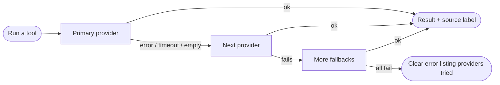

<div align="center">



<br><br>

[](#-install)
[](#-built-with)
[](#-appearance)
[](#-install)

<br>

[**Install**](#-install) · [**Features**](#-features) · [**Rauf.ai**](#-raufai) · [**API Hub**](#-api-hub) · [**Build**](#-build-from-source) · [**Structure**](#-project-structure)

</div>

<br>

> **A fast, minimal Android browser with a built-in AI assistant and a 34-tool API Hub.**
> Chromium-based WebView, wrapped in a clean Material 3 interface.

<br>

## At a glance

<div align="center">

| 🌐 | 🤖 | 🧰 | 🎨 | 🔒 |
|:---:|:---:|:---:|:---:|:---:|
| **Multi-tab**<br>+ incognito | **Rauf.ai**<br>model picker | **34 tools**<br>with fallbacks | **6 themes**<br>8 accents | **HTTPS-only**<br>no tracking opt-ins |

</div>

<br>

## ✨ Features

<table>
<tr>
<td width="50%" valign="top">

#### 🌐 Browse
- Multi-tab browsing and tab switcher
- Per-tab incognito and desktop mode
- Find in page, adjustable text zoom
- Bookmarks, history, download manager
- Command palette for quick actions
- Google, DuckDuckGo, Bing, Brave, Ecosia, Startpage
- Start page with shortcuts, recents, wallpapers
- Can be set as the default browser

</td>
<td width="50%" valign="top">

#### 🔒 Privacy
- Incognito keeps no history, cookies, site data or form entries
- HTTPS-only mode, pop-up blocking, Do Not Track
- Cookie and third-party cookie controls
- Camera, mic and location only on request
- SSL errors are blocked, never bypassed
- One-tap clearing of cache and cookies
- Settings export and import (JSON)

</td>
</tr>
</table>

> [!NOTE]
> Incognito does not make you anonymous to websites, your network or your provider.

<br>

## 🤖 Rauf.ai

An assistant that lives inside the browser.

| | |
|---|---|
| **Model picker** | Name, provider, description and tier badge per model (GPT-6, Claude Opus 4.5, Gemini 2.5 Pro, Llama 4 Maverick, Flux Ultra and more) |
| **Address bar commands** | `/ai` · `/ask` · `/chat` · `/gpt` · `/gemini` followed by your question |
| **Page context** | Optional: title, address and a snippet of the current page |
| **Transparent replies** | Shows which provider answered and which were tried first |
| **Your prompt** | Editable system prompt, last used model remembered |

<br>

## 🧰 API Hub

34 tools in four groups, backed by 200+ provider endpoints.

| Group | Tools |
|---|---|
| ⬇️ **Downloaders** | YouTube video and MP3, Instagram, Facebook, TikTok, Twitter/X, Pinterest, Spotify, MediaFire, CapCut, Terabox, Drive, all-in-one, APK lookup |
| 🧠 **AI** | Chat, image generator |
| 🔎 **Search** | Web, code, YouTube, lyrics, news, weather, countries, currency, crypto, Wikipedia, dictionary |
| 🎭 **Media and fun** | Wallpapers, anime, memes, quotes, stickers, logo maker, translate, QR, screenshots, web and social tools |

**Built-in utilities:** calculator, notes, to-do, reminders, password generator, hash, Base64, JSON formatter, unit converters.

### Smart fallback



Open **API Status** to check providers, switch them on or off and reorder them. Optional personal keys (Shizo, PrinceTech, Groq, OpenWeatherMap, NewsAPI, Giphy, OMDB, ImgBB, NexOracle, GiftedTech, Telegram bot token) stay on your device.

<br>

## 🎨 Appearance

| | |
|---|---|
| **Themes** | System · AMOLED Black · AMOLED White · Liquid Glass · White · Black |
| **Accents** | Default · Ocean Blue · Coral Orange · Electric Violet · Emerald · Rose · Cyan · Amber |
| **Comfort** | UI font size, page text zoom, reduced motion |
| **Typography** | Plus Jakarta Sans · Space Grotesk · JetBrains Mono |

<br>

## 📲 Install

Every push to `main` builds a debug APK with GitHub Actions.

1. Open the **[Releases](../../releases)** page (or the latest workflow run, artifact `app-debug-apk`)
2. Download the `.apk`
3. Open it on your phone and allow installs from your browser or file manager

> [!WARNING]
> APKs are signed with a temporary debug key. They are for testing, not Play Store releases.

**Requires** Android 7.0 (API 24) or newer.

<br>

## 🛠 Build from source

Requires JDK 17+, Android SDK (compile SDK 36) and Gradle 9.3.1, or Android Studio.

```bash
git clone https://github.com/mansoorwanimansoorwani23-collab/Rauf-Browser-.git
cd Rauf-Browser-

# the debug build expects ./debug.keystore (git-ignored)
keytool -genkeypair -keystore debug.keystore -storepass android \
  -alias androiddebugkey -keypass android \
  -dname "CN=Android Debug,O=Android,C=US" \
  -keyalg RSA -keysize 2048 -validity 10000

gradle :app:assembleDebug
```

Output: `app/build/outputs/apk/debug/app-debug.apk`

<details>
<summary><b>Release signing</b></summary>

<br>

| Variable | Meaning |
|---|---|
| `KEYSTORE_PATH` | keystore path (default `./my-upload-key.jks`) |
| `STORE_PASSWORD` | keystore password |
| `KEY_PASSWORD` | key password (alias `upload`) |

</details>

<details>
<summary><b>Tests</b></summary>

<br>

```bash
gradle :app:testDebugUnitTest
```

JUnit + Robolectric. `ProviderFailoverTest` covers the primary-then-fallback logic.

</details>

<br>

## 🗂 Project structure

```text
app/src/main/java/com/example/
├── MainActivity.kt
├── ai/             model selection, prompts, provider fallback
├── api/            provider registry, normalised API engine, clients
├── core/           URL resolver, search engines, network monitor
├── data/local/     Room, DAOs, DataStore, repository
├── engine/         WebView manager, tab models, download controller
├── ui/
│   ├── components/ glass components, bars, dialogs, command palette
│   ├── screens/    home, tabs, bookmarks, history, downloads, settings,
│   │               AI sheet, API Hub, API Status, utilities
│   └── theme/      colours, typography, theme modes
└── viewmodel/      BrowserViewModel
```

## 🧱 Built with

`Kotlin` · `Jetpack Compose` · `Material 3` · `Room` · `DataStore` · `OkHttp` · `Coil` · `Android WebView` · `GitHub Actions`

<br>

## 📌 Good to know

- The API Hub uses public third-party APIs that this project does not run. They can be slow or go offline, hence the fallbacks and status screen.
- Download only content you have the right to download.
- The app builds without a `google-services.json` file.

## 🗺 Roadmap

- [ ] Ad and tracker blocking
- [ ] Reader mode
- [ ] Bookmark and history sync
- [ ] Release signing and Play Store build

## 📄 License

No license file yet. Add a `LICENSE` file (for example MIT) to define how others may use the code.

<br>

<div align="center">

**Made by RAUF**

<sub>Clean. Fast. Private.</sub>

</div>
