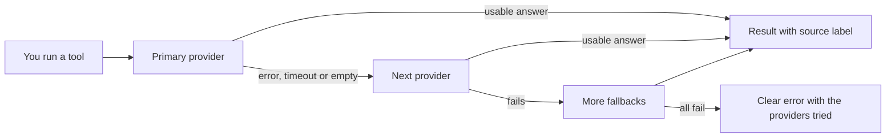

<div align="center">


<br>

[](#install)
[](#built-with)
[](#appearance)
[](#install)

**[Install](#install)** &nbsp;·&nbsp; **[Features](#features)** &nbsp;·&nbsp; **[Rauf.ai](#raufai)** &nbsp;·&nbsp; **[API Hub](#api-hub)** &nbsp;·&nbsp; **[Build](#build-from-source)** &nbsp;·&nbsp; **[Structure](#project-structure)**

</div>

<br>

Rauf Browser is a fast, minimalist Android browser built with Jetpack Compose. It renders pages with the system Chromium-based WebView and wraps them in a clean Material 3 interface with tabs, incognito mode, a download manager and a command palette.

Two things set it apart:

|  |  |
|---|---|
| **Rauf.ai** | A built-in AI assistant with a model picker. Ask from the address bar or from a bottom sheet, with the current page as optional context. |
| **API Hub** | 34 downloaders, search tools, media tools and utilities. Every tool has several providers and falls back automatically when one fails. |

<br>

## Features

<table>
<tr>
<td width="50%" valign="top">

### Browse
- Multi-tab browsing with a tab switcher
- Per-tab incognito mode
- Desktop mode per tab
- Find in page, adjustable text zoom
- Bookmarks, history and a download manager
- Command palette for quick actions
- Six search engines: Google, DuckDuckGo, Bing, Brave, Ecosia, Startpage
- Start page with shortcuts, frequent sites, recents and wallpapers
- Set it as your default browser for web links

</td>
<td width="50%" valign="top">

### Stay private
- Incognito keeps no history, cookies, site data or form entries, and uses no cache
- HTTPS-only mode, pop-up blocking, Do Not Track
- Cookie and third-party cookie controls
- Camera, microphone and location only when a site asks, with a master switch for each
- SSL errors are blocked, never bypassed
- Clear cache, cookies or everything in one tap
- Settings export and import as JSON

</td>
</tr>
</table>

> [!NOTE]
> Incognito mode does not make you anonymous to the sites you visit, your network or your internet provider. The app tells you this on the incognito screen.

## Rauf.ai

An assistant that lives inside the browser.

- **Model picker** with name, provider, description and tier badge for every model, such as GPT-6, Claude Opus 4.5, Gemini 2.5 Pro and Llama 4 Maverick, plus image models like Flux Ultra
- **Address bar commands**: type `/ai`, `/ask`, `/chat`, `/gpt` or `/gemini` followed by your question
- **Page context** (optional): the assistant can use the title, address and a snippet of the page you are on
- **Transparent answers**: each reply shows which provider answered and which ones were tried first
- Editable system prompt, and the last model you used is remembered

## API Hub

34 tools in four groups, backed by more than 200 provider endpoint definitions.

| Group | Tools |
|---|---|
| **Downloaders** | YouTube video and MP3, Instagram, Facebook, TikTok, Twitter/X, Pinterest, Spotify, MediaFire and cloud links, CapCut, Terabox and Drive, all-in-one, APK lookup |
| **AI** | AI chat, AI image generator |
| **Search** | Web and code search, YouTube search, lyrics, news, weather, country info, currency, crypto, Wikipedia, dictionary |
| **Media and fun** | Wallpapers, anime hub, memes and quotes, effects and stickers, logo and text maker, translate, QR code, website screenshot, web and social tools |

### How the fallback works



- Open **API Status** to check providers, switch them on or off and change their order
- Add your own keys in settings if you want to use them: Shizo, PrinceTech, Groq, OpenWeatherMap, NewsAPI, Giphy, OMDB, ImgBB, NexOracle, GiftedTech or a Telegram bot token. They are stored on your device
- Your tool history and favourite tools are kept for quick access

### Built-in utilities

Calculator, notes, to-do, reminders, password generator, hash, Base64, JSON formatter and unit converters.

## Appearance

| | |
|---|---|
| **Themes** | System, AMOLED Black, AMOLED White, Liquid Glass, White, Black |
| **Accents** | Default, Ocean Blue, Coral Orange, Electric Violet, Emerald, Rose, Cyan, Amber |
| **Comfort** | UI font size, page text zoom, reduced motion |
| **Home** | Built-in wallpapers, custom homepage URL, optional shortcut, frequent, recent and bookmark rows |
| **Type** | Plus Jakarta Sans, Space Grotesk, JetBrains Mono |

## Install

Every push to `main` builds a debug APK with GitHub Actions and publishes it on the **[Releases](../../releases)** page. Download the latest `.apk`, open it on your phone and allow installs from your browser or file manager when Android asks.

The same file is also kept as the `app-debug-apk` artifact of each workflow run.

> [!WARNING]
> Published APKs are signed with a temporary debug key. They are for testing and are not Play Store releases.

**Requirements:** Android 7.0 (API 24) or newer.

## Build from source

You need JDK 17 or newer, the Android SDK (compile SDK 36) and Gradle 9.3.1, or Android Studio. The repository does not include the Gradle wrapper script.

```bash
git clone https://github.com/mansoorwanimansoorwani23-collab/Rauf-Browser-.git
cd Rauf-Browser-

# the debug build expects ./debug.keystore (git-ignored), so create one:
keytool -genkeypair -keystore debug.keystore -storepass android \
  -alias androiddebugkey -keypass android \
  -dname "CN=Android Debug,O=Android,C=US" \
  -keyalg RSA -keysize 2048 -validity 10000

gradle :app:assembleDebug
```

The APK is written to `app/build/outputs/apk/debug/app-debug.apk`. In Android Studio, open the folder, wait for the Gradle sync and run the `app` configuration.

<details>
<summary><b>Release build and signing</b></summary>

<br>

The release build reads its signing settings from the environment:

| Variable | Meaning |
|---|---|
| `KEYSTORE_PATH` | path to your keystore (default `./my-upload-key.jks`) |
| `STORE_PASSWORD` | keystore password |
| `KEY_PASSWORD` | key password (the key alias is `upload`) |

</details>

<details>
<summary><b>Run the tests</b></summary>

<br>

```bash
gradle :app:testDebugUnitTest
```

Tests use JUnit and Robolectric. `ProviderFailoverTest` checks the primary-then-fallback behaviour of the API layer.

</details>

## Project structure

```text
app/src/main/java/com/example/
├── MainActivity.kt
├── ai/             model selection, prompts, provider fallback
├── api/            provider registry, normalised API engine, endpoint clients
├── core/           URL resolver, search engines, network monitor
├── data/local/     Room database, DAOs, DataStore preferences, repository
├── engine/         WebView manager, tab models, native download controller
├── ui/
│   ├── components/ glass components, browser bars, dialogs, command palette
│   ├── screens/    home, tabs, bookmarks, history, downloads, settings,
│   │               AI sheet, API Hub, API Status, downloader hub, utilities
│   └── theme/      colours, typography, theme modes
└── viewmodel/      BrowserViewModel
```

## Built with

Kotlin · Jetpack Compose · Material 3 · Room · DataStore · OkHttp · Coil · Android WebView · GitHub Actions

## Good to know

- The API Hub uses public third-party web APIs that this project does not run. Some can be slow, change or go offline without notice, which is why each tool has fallbacks and a status screen.
- Downloading can be limited by the terms of the source site and by copyright law. Download only what you have the right to download.
- The app builds without a `google-services.json` file.

## Roadmap

- [ ] Ad and tracker blocking
- [ ] Reader mode
- [ ] Bookmark and history sync
- [ ] Release signing and a Play Store build

## License

No license file has been added yet. Add a `LICENSE` file (for example MIT) to say how others may use the code.

<br>

<div align="center">

Made by **RAUF**

<sub>Clean. Fast. Private.</sub>

</div>
